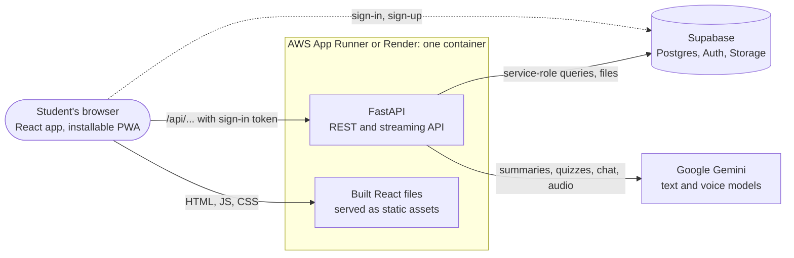
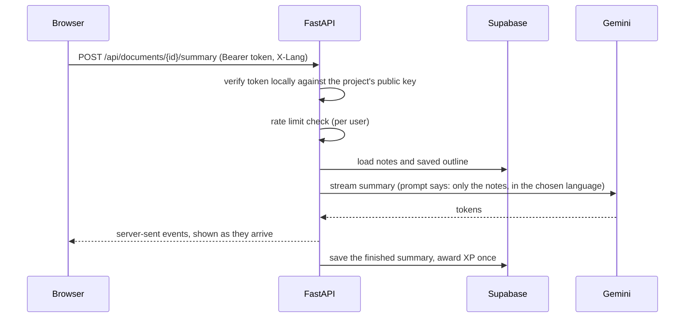
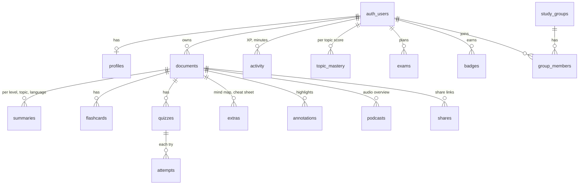

# Architecture

StudyMate AI turns a student's own notes into summaries, flashcards, quizzes, a study plan and more, then tracks what they have mastered.

## The big picture

- **One container, one URL.** The React build is copied into the image and served by FastAPI, so there is no CORS setup and nothing else to host.
- **Supabase** is the database, the sign-in service, and file storage (audio overviews). The browser talks to Supabase only to sign in. Every data read and write goes through FastAPI.
- **Gemini** writes everything generated: summaries, quiz questions, flashcards, mind maps, cheat sheets, marking of written answers, chat replies, the two-host script, and the voices.

## One request, end to end

## Why it is built this way

| Choice | Reason |
|---|---|
| **FastAPI beside Supabase** instead of calling Supabase from the browser | The Gemini key and Supabase service key must never reach a browser, and every AI call needs checking, limiting and saving on the server. |
| **Row-level security still on** | Even though the server uses a privileged key, the browser holds only the public key, and RLS limits that key to the signed-in user's own rows. A leaked public key exposes nothing. |
| **Tokens verified locally** | Supabase signs access tokens with a key pair. The server checks the signature against the public key instead of asking Supabase on every request, which cut about 1.5 seconds from each call. |
| **Independent queries run side by side** | Each database call is a network round trip of 200 to 500 ms. Pages that need five tables now wait for the slowest one, not the sum. |
| **Summaries, podcasts and extras stored per language** | Switching language never overwrites the other copy, and a regenerated page costs no extra AI call. |
| **Notes are split into topics once** | The outline is saved, so topic-wise summaries, quizzes, the planner and weak-topic advice all use the same topic names. |
| **Plain-Python study logic** (`backend/logic.py`) | Spaced repetition, levels, streak freezes, badges, the planner and note search need no database, so they are unit tested directly. |
| **Model fallback** | If the main Gemini model is busy or out of free quota, requests move to the next model in `GEMINI_FALLBACK_MODELS`. |

## Data model

`activity` is the single source of truth for XP, streaks, level and badges. Nothing is stored twice, so numbers can never drift apart.

## Study logic worth knowing

- **Spaced repetition (SM-2):** four ratings; Again returns the card in ten minutes, Good grows the gap by the card's ease factor.
- **Level:** level `n` starts at `50 * (n - 1)^2` XP.
- **Streak freeze:** a streak survives one missed day per freeze; a student gets one at the start and one more every third level. It is worked out from activity history, so there is nothing to backfill.
- **Study plan:** each topic has two steps (read it, then check it with a quiz). Cards due come first, then weak topics, then unread topics, with the daily amount set by the days left. A timed mock exam appears in the last three days.
- **Ask your library:** BM25 ranking over passages of the student's own notes, with no embedding service.

## Performance design

The aim is every page showing content within two seconds on an ordinary connection.

- Login checks are local (no network).
- Independent database queries run in parallel.
- The browser remembers reads for 15 seconds and shares identical in-flight requests, so moving between pages is instant.
- The first download is about 160 KB gzipped: pages load on demand, the markdown renderer, Supabase and React are separate cached chunks, and each translation is its own file loaded only when chosen.
- Page code is prefetched quietly after sign-in.
- Requests time out after 15 seconds (reads) and retry once, instead of hanging.

## Deployment

See [`deploy/README.md`](../deploy/README.md). The same Docker image runs on AWS App Runner (`deploy/deploy.sh`, keys in AWS Secrets Manager) or on Render (`render.yaml`, keys as service settings), and the container takes its port from `$PORT`. The GitHub workflow builds and tests on every push.
